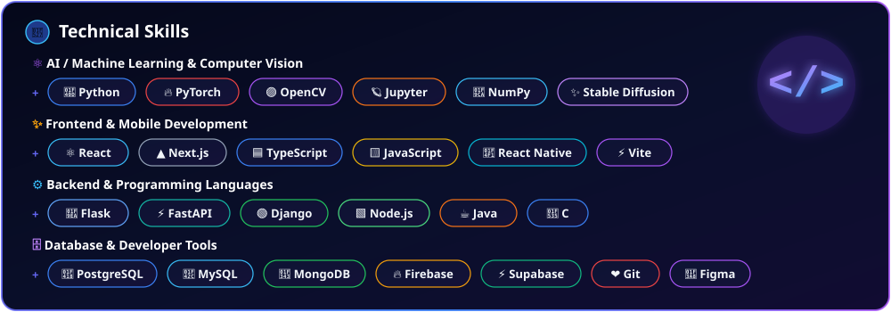

<!-- ══════════════════════════════════════════════════════════════════════════════ -->
<!-- 1. ANIMATED INTRODUCTION & PROFESSIONAL HEADLINE                               -->
<!-- ══════════════════════════════════════════════════════════════════════════════ -->

<!-- ══════════════════════════════════════════════════════════════════════════════ -->
<!-- 2. PROFILE INFORMATION & SOCIAL LINKS                                          -->
<!-- ══════════════════════════════════════════════════════════════════════════════ -->

  
  &nbsp;
  
  &nbsp;
  
  &nbsp;
  

<!-- ══════════════════════════════════════════════════════════════════════════════ -->
<!-- 3. ABOUT ME (WITH GLOWING AI MICROCHIP ILLUSTRATION)                           -->
<!-- ══════════════════════════════════════════════════════════════════════════════ -->

 

<!-- ══════════════════════════════════════════════════════════════════════════════ -->
<!-- 4. FEATURED PROJECTS WITH ATTRACTIVE PROJECT CARDS                             -->
<!-- ══════════════════════════════════════════════════════════════════════════════ -->

## 🚀 Featured Projects

|  |  |  |
| :---: | :---: | :---: |
| **[AI Saree Draping Studio](https://github.com/VaisnaviRajaratnam14/AI-SAREE)**   [`AI-SAREE`](https://github.com/VaisnaviRajaratnam14/AI-SAREE) • [`SareeDrap`](https://github.com/VaisnaviRajaratnam14/SareeDrap) | **[The Nirals Restaurant](https://github.com/VaisnaviRajaratnam14/TheNirals_Restaurant)**   [`View Repository →`](https://github.com/VaisnaviRajaratnam14/TheNirals_Restaurant) | **[NeonLabz Mobile App](https://github.com/VaisnaviRajaratnam14/NeonLabz_MobileApplication)**   [`View Repository →`](https://github.com/VaisnaviRajaratnam14/NeonLabz_MobileApplication) |

 

|  |  |
| :---: | :---: |
| **[Ayurvedic Shop Frontend](https://github.com/VaisnaviRajaratnam14/Aayurvedic-shop-front-end)**   [`View Repository →`](https://github.com/VaisnaviRajaratnam14/Aayurvedic-shop-front-end) | **[BananaAPI Game](https://github.com/VaisnaviRajaratnam14/BananaAPI_Game)**   [`View Repository →`](https://github.com/VaisnaviRajaratnam14/BananaAPI_Game) |

 

<!-- ══════════════════════════════════════════════════════════════════════════════ -->
<!-- 5 - 8. TECHNICAL SKILLS (UNIFIED CARD WITH GLOWING </> EMBLEM)                 -->
<!-- ══════════════════════════════════════════════════════════════════════════════ -->

  

 

<!-- ══════════════════════════════════════════════════════════════════════════════ -->
<!-- 9, 10 & 11. GITHUB STATISTICS, CONTRIBUTION STREAK & TOP LANGUAGES             -->
<!-- ══════════════════════════════════════════════════════════════════════════════ -->

  
  

 

<!-- ══════════════════════════════════════════════════════════════════════════════ -->
<!-- 12. ANIMATED GITHUB CONTRIBUTION SNAKE (GREEN CELLS IN COSMIC CARD)            -->
<!-- ══════════════════════════════════════════════════════════════════════════════ -->

  <picture>
    <source media="(prefers-color-scheme: dark)" srcset="./assets/snake-dark.svg" />
    <source media="(prefers-color-scheme: light)" srcset="./assets/snake-dark.svg" />
    
  </picture>

 

<!-- ══════════════════════════════════════════════════════════════════════════════ -->
<!-- 13. PROFESSIONAL CONTACT SECTION & FLOWING NEON WAVES                          -->
<!-- ══════════════════════════════════════════════════════════════════════════════ -->

  

