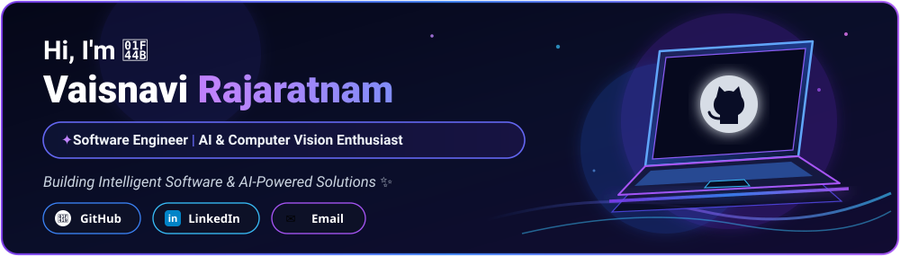
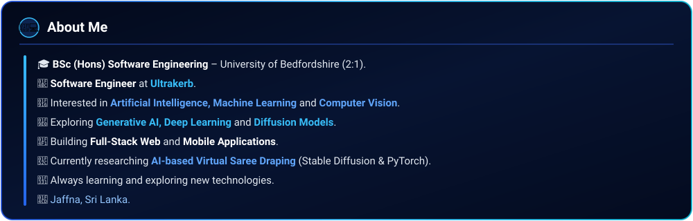
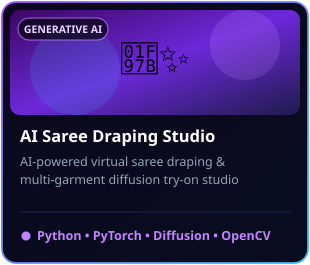
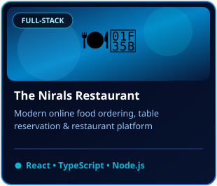
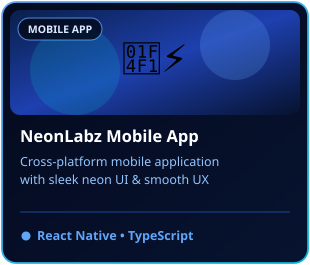
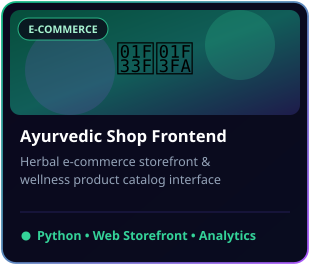
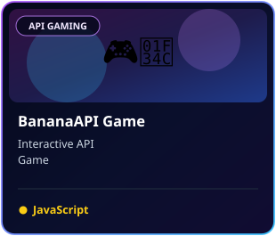
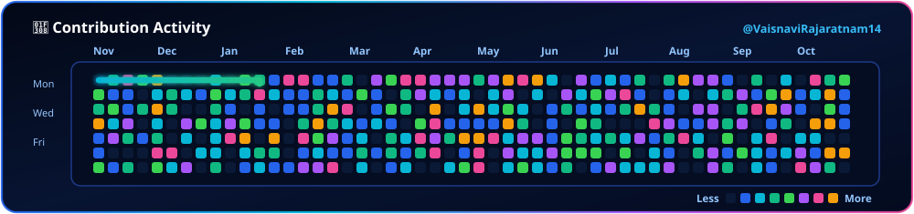
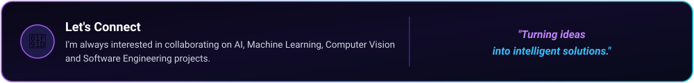

<!-- ══════════════════════════════════════════════════════════════════════════════ -->
<!-- 1. ANIMATED INTRODUCTION & PROFESSIONAL HEADLINE                               -->
<!-- ══════════════════════════════════════════════════════════════════════════════ -->

 

<!-- Animated Typing Headline -->

 

<!-- ══════════════════════════════════════════════════════════════════════════════ -->
<!-- 2. PROFILE INFORMATION & SOCIAL LINKS                                          -->
<!-- ══════════════════════════════════════════════════════════════════════════════ -->

  
  &nbsp;
  
  &nbsp;
  
  &nbsp;
  
  &nbsp;
  

---

<!-- ══════════════════════════════════════════════════════════════════════════════ -->
<!-- 3. ABOUT ME                                                                    -->
<!-- ══════════════════════════════════════════════════════════════════════════════ -->

  

<b>⚡ Quick Profile Overview (Text View)</b>

 

- 🎓 **Education:** BSc (Hons) Software Engineering – **University of Bedfordshire (2:1)**.
- 💼 **Role:** Software Engineer at **Ultrakerb**.
- 🤖 **Specialization:** Artificial Intelligence, Machine Learning, Computer Vision, and Full-Stack Development.
- 🧠 **Research & Innovation:** Exploring Generative AI, Deep Learning, and Diffusion Models — currently researching **AI-based Virtual Saree Draping** (`Stable Diffusion`, `PyTorch`, `OpenCV`).
- 📱 **Engineering:** Building scalable Full-Stack Web and Cross-Platform Mobile Applications.
- 🌱 **Mindset:** Always learning and exploring cutting-edge technologies.
- 📍 **Location:** Jaffna, Sri Lanka.

---

<!-- ══════════════════════════════════════════════════════════════════════════════ -->
<!-- 4. FEATURED PROJECTS WITH ATTRACTIVE PROJECT CARDS                             -->
<!-- ══════════════════════════════════════════════════════════════════════════════ -->

## 🚀 Featured Projects

|  |  |  |
| :---: | :---: | :---: |
| **[AI Saree Draping Studio](https://github.com/VaisnaviRajaratnam14/AI-SAREE)**   *AI-powered virtual saree draping & multi-garment diffusion try-on system*   [`AI-SAREE`](https://github.com/VaisnaviRajaratnam14/AI-SAREE) • [`SareeDrap`](https://github.com/VaisnaviRajaratnam14/SareeDrap) | **[The Nirals Restaurant](https://github.com/VaisnaviRajaratnam14/TheNirals_Restaurant)**   *Full-stack restaurant ordering, menu & table reservation platform*   [`View Repository →`](https://github.com/VaisnaviRajaratnam14/TheNirals_Restaurant) | **[NeonLabz Mobile Application](https://github.com/VaisnaviRajaratnam14/NeonLabz_MobileApplication)**   *Cross-platform mobile application built with modern UI/UX architecture*   [`View Repository →`](https://github.com/VaisnaviRajaratnam14/NeonLabz_MobileApplication) |

 

|  |  |
| :---: | :---: |
| **[Ayurvedic Shop Frontend](https://github.com/VaisnaviRajaratnam14/Aayurvedic-shop-front-end)**   *E-commerce storefront & wellness product catalog platform*   [`View Repository →`](https://github.com/VaisnaviRajaratnam14/Aayurvedic-shop-front-end) | **[BananaAPI Game](https://github.com/VaisnaviRajaratnam14/BananaAPI_Game)**   *Interactive puzzle game powered by REST API integration & dynamic state*   [`View Repository →`](https://github.com/VaisnaviRajaratnam14/BananaAPI_Game) |

---

<!-- ══════════════════════════════════════════════════════════════════════════════ -->
<!-- 5 - 8. TECHNICAL SKILLS                                                        -->
<!-- ══════════════════════════════════════════════════════════════════════════════ -->

## 🛠️ Technical Skills

### 🧠 AI, Machine Learning & Computer Vision

  
  
  
  
  

### 💻 Frontend & Mobile Development

  
  
  
  
  
  

### ⚙️ Backend & Programming Languages

  
  
  
  
  
  

### 🗄️ Database & Developer Tools

  
  
  
  
  
  
  

---

<!-- ══════════════════════════════════════════════════════════════════════════════ -->
<!-- 9, 10 & 11. GITHUB STATISTICS, TOP PROGRAMMING LANGUAGES & CONTRIBUTION STREAK -->
<!-- ══════════════════════════════════════════════════════════════════════════════ -->

## 📊 GitHub Analytics & Contribution Streak

  
  

 

  

---

<!-- ══════════════════════════════════════════════════════════════════════════════ -->
<!-- 12. ANIMATED GITHUB CONTRIBUTION SNAKE                                         -->
<!-- ══════════════════════════════════════════════════════════════════════════════ -->

## 🐍 Contribution Activity

  <!-- Renders the live GitHub Actions generated snake from the `output` branch, with instant fallback to the embedded cyberpunk SVG -->
  <picture>
    <source media="(prefers-color-scheme: dark)" srcset="./assets/snake-dark.svg" />
    <source media="(prefers-color-scheme: light)" srcset="./assets/snake-dark.svg" />
    
  </picture>

---

<!-- ══════════════════════════════════════════════════════════════════════════════ -->
<!-- 13. PROFESSIONAL CONTACT SECTION                                               -->
<!-- ══════════════════════════════════════════════════════════════════════════════ -->

  

  
  &nbsp;&nbsp;
  
  &nbsp;&nbsp;
  

 

**💜 Thanks for visiting my profile!**

